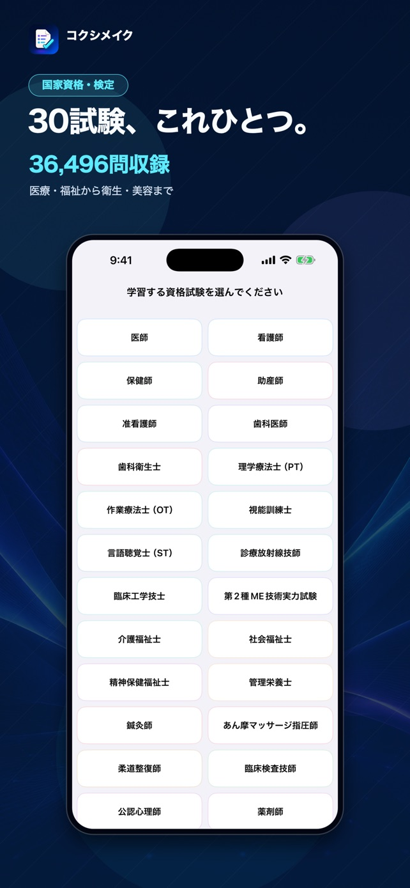
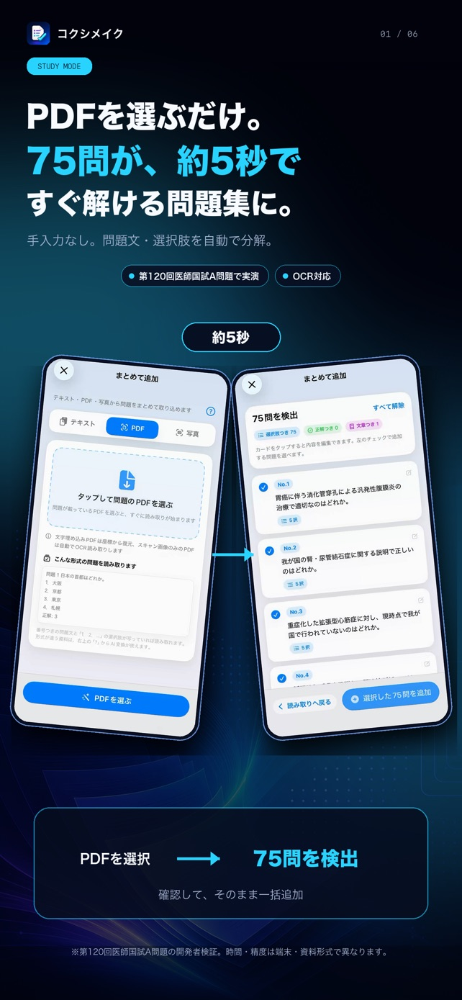
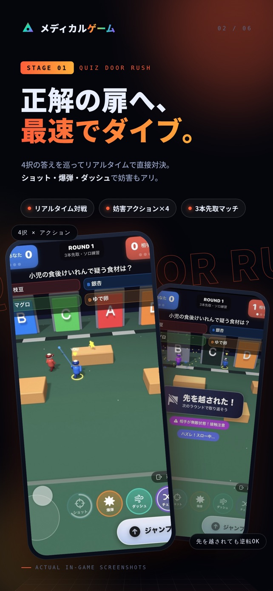
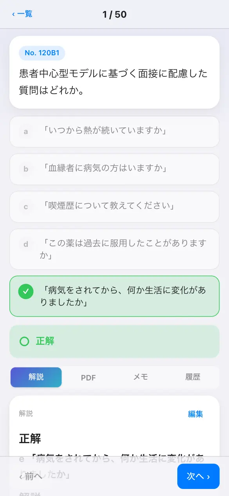
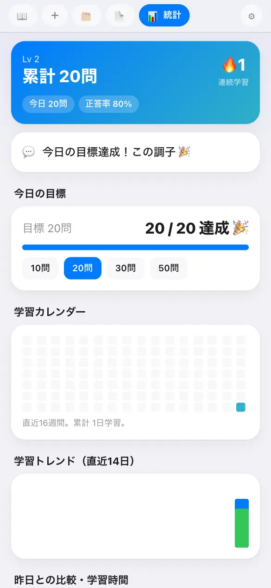
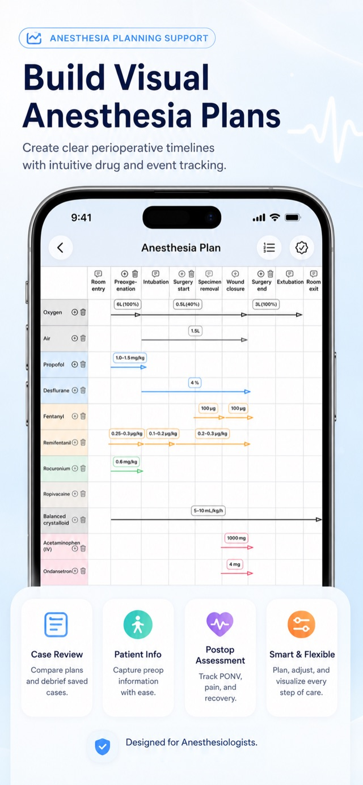

# Ryota Uematsu

医師です。臨床の現場で感じた不便を、自分でアプリにして解決しています。App Storeで8本のアプリを公開しています。

- X: [@igakunote](https://x.com/igakunote)（フォロワー約1.7万人）
- コクシメイク: [kokushimake.com](https://kokushimake.com/)

> アプリのソースコードは非公開のため、このページではアプリの紹介だけを載せています。

## 医療のアプリ

### コクシメイク（iOS・Web）

国家試験の過去問を、スマホとブラウザで1問ずつ解ける学習アプリです。医師・看護師・薬剤師などの医療系を中心に、福祉・衛生・美容まで30試験を収録しています。

国家試験の過去問と正答は、試験の実施機関がPDFで公表しています。ただ、問題と正答のPDFを見比べながら解くのは手間がかかり、実習や仕事の合間に勉強する受験生には向きません。コクシメイクは、公表された問題と正答を1問ずつ解ける形に整え、解説と一緒にその場で答え合わせできるようにしました。

- **30試験・3万6千問以上の過去問**: 医師、看護師、保健師、助産師、薬剤師、歯科医師、理学療法士、作業療法士、診療放射線技師、臨床検査技師、介護福祉士、社会福祉士など
- **解き方を選べる**: 回次別・分野別の演習、本番形式のテスト、学習記録、暗記カード
- **PDF・写真から問題集を作成**: 選んだPDFや写真から、問題文と選択肢を自動で分けて取り込みます（OCR対応）
- **クイズ対戦ゲーム「QUIZ DOOR RUSH」**: 正解の扉へ走る3Dゲーム。iOS版はオンライン対戦にも対応
- **iOS版**はオフラインで学習でき、iCloudで端末間を同期。**Web版**は登録不要で、学習データはブラウザの中だけに保存します

| 試験を選ぶ（iOS） | PDFから問題集を作る（iOS） | QUIZ DOOR RUSH（iOS） |
| :---: | :---: | :---: |
|  |  |  |

| 過去問を解く（Web） | 学習記録（Web） |
| :---: | :---: |
|  |  |

**技術構成**: iOSはSwiftUI、SwiftData、SceneKit（3Dゲーム）、PDFKit、Firebase。WebはNext.js（過去問ページを静的に生成）と、React・Vite・Three.jsの学習アプリ。配信はCloudflare Pages / R2 / Workers。問題データは、公式PDFから問題・選択肢・正答・図を取り出す処理を作り、公式正答との照合と、iOS版とWeb版の採点結果が一致するかの機械検証を行っています。

[App Store](https://apps.apple.com/jp/app/id6786567231)（2026年7月公開） / [Web版](https://kokushimake.com/)

### 麻酔計画（iOS）

術前評価・術中の麻酔計画・術後回診を1症例にまとめる、タイムライン型の麻酔計画アプリです。薬剤とイベントのグリッドで計画の流れを一目で伝え、引き継ぎに必要な情報を1か所に集めます。レジデントが単独で立てた計画と、指導医の確認後の計画を分けて記録し、教育の振り返りに使えます。症例データは端末の中だけに保存します。

- 2026年 日本麻酔科学会 第73回学術集会で発表
- [App Store](https://apps.apple.com/jp/app/id6760400252)（2026年5月公開）

 

### みんなの当直表（iOS）

当直表の希望の収集から自動作成、確定後の交替までを引き受けるアプリです。週や月の上限、当直の間隔、同じ枠に入れない組み合わせを考慮し、回数だけでなく給料の差まで公平になるように割り当てます。

- [App Store](https://apps.apple.com/jp/app/id6756843278)（2025年12月公開）

## そのほかのアプリ

- [共通テスト対戦ゲーム](https://apps.apple.com/jp/app/id6791876010)
- [漢字対戦ゲーム](https://apps.apple.com/jp/app/id6796533026)
- [QuizDoorRush](https://apps.apple.com/jp/app/id6788986810)
- [以心伝心 − ふたりの相性診断ゲーム](https://apps.apple.com/jp/app/id6795802709)
- [PinShot - 写真が地図に残る思い出マップ](https://apps.apple.com/jp/app/id6793808488)

## 開発のしかた

アプリはClaude CodeとCodexを使って、一人で開発しています。例えばコクシメイクでは、Webサイト全ページのデザイン刷新、看護師・保健師・助産師の追加6回分（920問）の解説の作成と見直し、3Dクイズゲームのキャラクター制作などを、Claude Codeと一緒に進めました。

## English summary

I am a physician in Japan who builds apps for problems I meet in clinical work, with eight apps on the App Store. KokushiMake is a study app for 30 Japanese national licensing exams (iOS and web). Anesthesia Plan is a timeline-based anesthesia planning app, presented at the 73rd Annual Meeting of the Japanese Society of Anesthesiologists (2026). Minna no Touchoku-hyo builds fair on-call rosters automatically. I build with Claude Code and Codex. App source code is private, so this page only introduces the apps.
